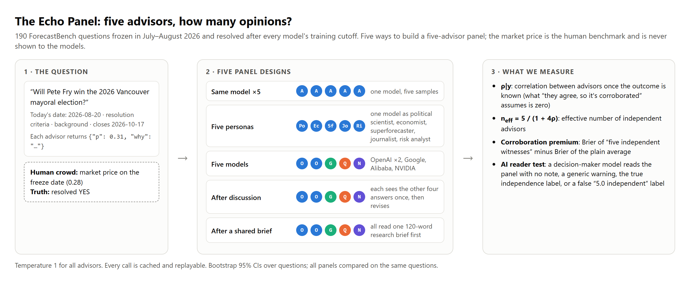
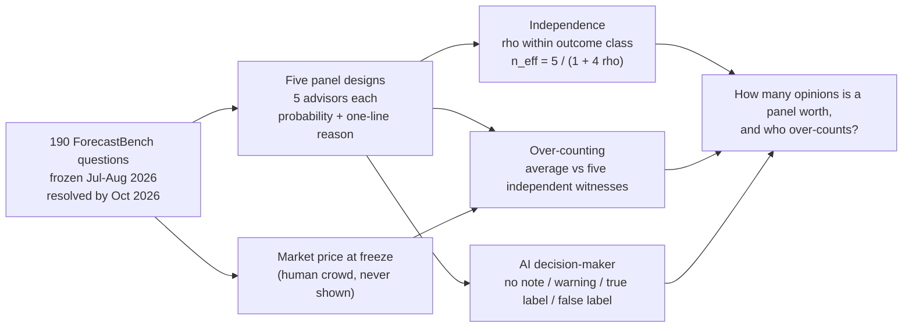
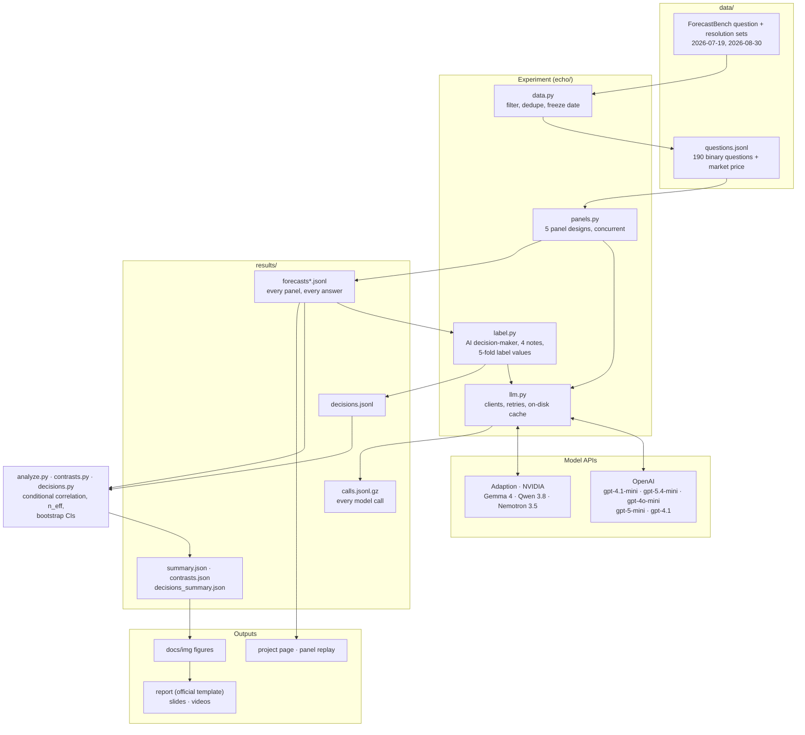
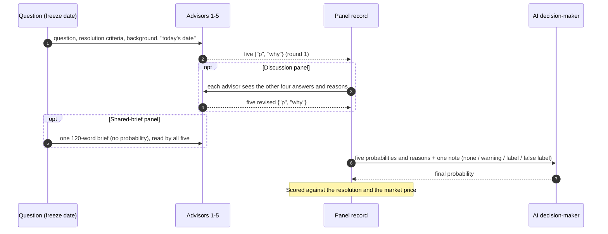
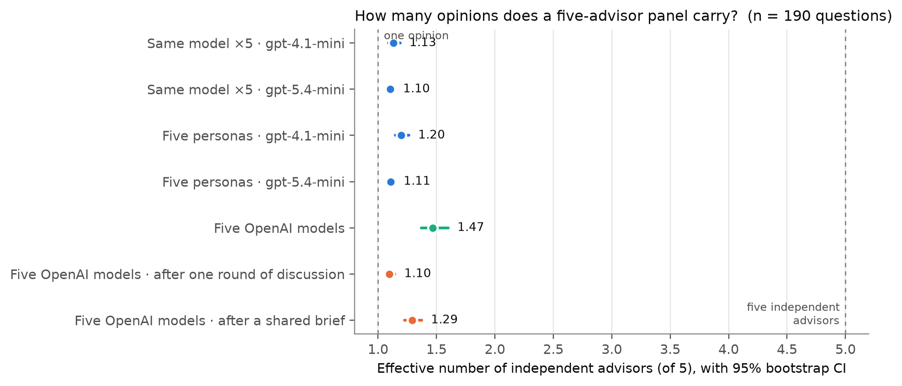
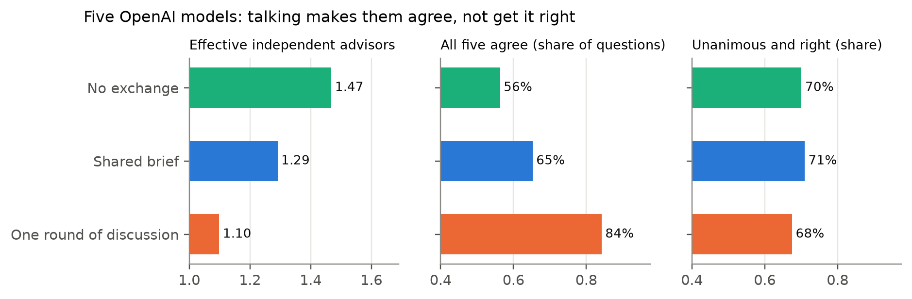
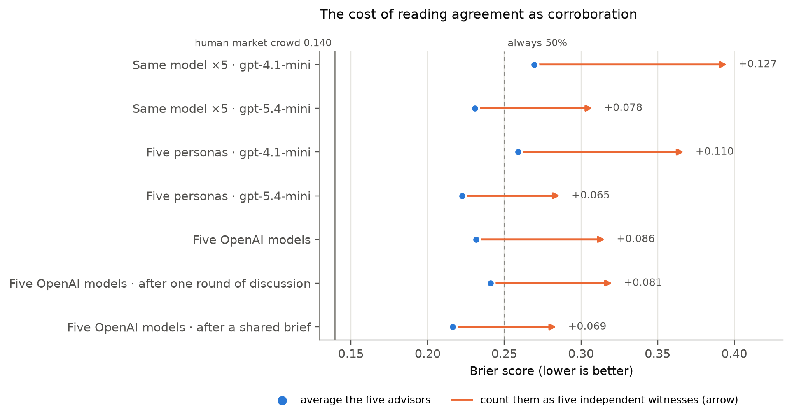

# The Echo Panel

**When AI advisors agree, how many independent opinions do you actually get? We built five-advisor AI panels the way products build them (one model sampled five times, one model playing five experts, five different models, the same five after talking, the same five after reading one shared brief), asked them 190 forecasting questions that had already resolved, and measured how much of their agreement was echo.**

Built by **Paras Adlakha** and **Harshita Adlakha** for the [Apart Research AI x Epistemics Research Sprint](https://apartresearch.com/sprints/ai-x-epistemics-research-sprint-2026-11-13-to-2026-11-15), 13–15 November 2026. Track 1 (Model Epistemics and Decision-Making Evals) and Track 2 (Trust Infrastructure).

**▶ [Replay the panels](https://parasadlakha.github.io/echo-panel/viewer.html)**: browse all 190 questions, see each advisor's probability and reason next to the prediction market and the real outcome, and watch a discussion round collapse a split panel into agreement. No setup or API key needed.

**📄 [Report (PDF)](report/EchoPanel-report.pdf)** · [Word version](report/EchoPanel-report.docx) · **🎬 [Pitch video](docs/video/EchoPanel-pitch.mp4)** (narrated slides) · [Demo](docs/video/EchoPanel-demo.mp4) (narrated replay) · **📑 [Slides (PDF)](docs/slides/EchoPanel-slides.pdf)** · [PowerPoint](docs/slides/EchoPanel-slides.pptx) (speaker notes are the talk script) · [Project page](https://parasadlakha.github.io/echo-panel/) · [Research brief](https://parasadlakha.github.io/echo-panel/research-brief.html)



*One question, five ways to build a five-advisor panel. The prediction market's price on the freeze date is the human benchmark and is never shown to the models.*

**Contents:** [The sprint](#the-sprint) · [The problem](#the-problem) · [What the experiment does](#what-the-experiment-does) · [Architecture](#architecture) · [How a panel works](#how-a-panel-works) · [Design](#design) · [Results](#results) · [Data and evidence](#data-and-evidence) · [Run it yourself](#run-it-yourself) · [Repository layout](#repository-layout) · [What we learned](#what-we-learned) · [What is new in this sprint](#what-is-new-in-this-sprint) · [Limitations and roadmap](#limitations-and-roadmap) · [Team](#team) · [References](#references) · [LLM usage](#llm-usage)

---

## The sprint

| | |
|---|---|
| **Event** | AI x Epistemics Research Sprint ([sprint page](https://apartresearch.com/sprints/ai-x-epistemics-research-sprint-2026-11-13-to-2026-11-15)) |
| **Dates and place** | 13–15 November 2026, online, with local hubs (Bangkok, Mérida, Bengaluru, Delhi, Madrid, NIT Agartala, Saarbrücken, Calgary, Cape Town, Chiang Mai); we took part online |
| **Organisers** | [Apart Research](https://apartresearch.com), with Alex Csaky as co-designer of the research tracks; [Adaption](https://adaptionlabs.ai) provided platform credits |
| **Tracks** | 1) Model Epistemics and Decision-Making Evals · 2) Trust Infrastructure · 3) Epistemic Products · 4) Open Track |
| **Ours** | Track 1 (main: how much a panel's agreement is worth, and how models read it) and Track 2 (the independence label as a signal people and machines can consume) |
| **Deliverable** | Research report (PDF) on the official template, ≤ 8 pages plus references and appendices, abstract 150–250 words, a required Limitations and Dual-Use / Ethical Considerations appendix; optional public repo and 3–5 minute video |
| **Judging** | Impact Potential and Innovation · Execution Quality · Presentation and Clarity (1–5 each) |
| **Prizes** | $2,000 across all tracks; top teams fast-tracked to the Apart Fellowship |
| **Talks we drew on** | S. Orestis Palermos, "Artificial Knowing: AI as Socio-Technical Epistemic Collaboration"; Jonathan Stray, "Destructive Feedback Loops between Conflict and Knowledge"; Owen Cotton-Barratt, keynote |

### What the brief asked for, and where it is here

| The brief | The Echo Panel |
|---|---|
| Track 1: "Does the model understand how solid its claims are?" and "Which model behaviours matter for real decision quality?" | We score panels and AI decision-makers against real outcomes and a human crowd, and separate how sure a panel looks from how often it is right |
| Track 1: benchmarks that stay meaningful; avoid contamination | Only questions frozen and resolved after every model's training cutoff (ForecastBench), so the measurement can be refreshed with each new question set |
| Track 2: "Build signals that both people and machines can consume"; "Which reliability techniques are hardest to cheat and easiest to audit?" | The independence label: one number computed from a panel's public track record, with a false-label arm that shows how it could be abused |
| Track 2: "When an AI system uses a reliability tool, does its behaviour and accuracy actually improve?" | Tested directly: two AI decision-makers with no note, a generic warning, the true label and a false label |
| Sprint-wide: dependence on systems nobody can evaluate; multi-agent risks (Hammond et al. 2025) | Panels of agents that confer before answering, measured before and after they talk |
| Report: variance and baselines | Bootstrap 95% CIs, paired contrasts on the same questions, a human-crowd baseline and the "always 50%" baseline |

---

## The problem

- AI products increasingly answer with a group: several models side by side, one model playing a panel of experts, or agents that confer before replying. A group that agrees looks like a stronger case than one voice.
- Agreement is evidence only when the sources are independent once you know the truth. A second expert who agrees adds evidence only if her opinion did not simply come from the first (Goldman 2001), and dependent sources have a hard ceiling on what they can tell you (Clemen & Winkler 1985).
- Language models share data, recipes and often retrieved documents, and models from different developers make similar mistakes (Kim et al. 2025; Goel et al. 2025). Social influence erodes a crowd's independence quickly (Lorenz et al. 2011).
- People read agreement among AI agents as social proof (Lee & Lee 2026). Nobody had measured how much independent evidence the agreement of product-style AI panels actually carries.

**Our bet:** if we hold the question fixed and change only how the five answers are produced, the effective number of independent advisors per design is a clean, comparable number, and comparing it with what agreement *looks* like tells us what over-counting costs.

---

## What the experiment does



| Panel | How the five answers are produced |
|---|---|
| **Same model ×5** | One model asked five times with an identical prompt (gpt-4.1-mini; gpt-5.4-mini) |
| **Five personas** | One model as a political scientist, an economist, a superforecaster, an investigative journalist and a risk analyst |
| **Five models** | gpt-4.1-mini, gpt-5.4-mini, gpt-4o-mini, gpt-5-mini, gpt-4.1 |
| **After discussion** | The same five, after each sees the other four answers and reasons once and revises |
| **After a shared brief** | The same five, after all read one 120-word neutral research brief |
| **Cross-developer (robustness)** | gpt-4.1-mini, gpt-5.4-mini, Gemma 4 31B (Google), Qwen 3.8 27B (Alibaba), Nemotron 3.5 30B (NVIDIA) |

---

## Architecture



Every model call is cached under a hash of the model, messages and sample index. Rerunning any step reads the cache and makes no new calls, so every number in the report can be regenerated from `results/calls.jsonl.gz`.

---

## How a panel works



Each advisor returns JSON: `{"p": probability of YES, "why": one sentence}`. Temperature is 1 for non-reasoning models; reasoning models use effort "low". The market price is never in any prompt.

---

## Design

| | |
|---|---|
| **Questions** | ForecastBench (Karger et al. 2025) market questions from Polymarket, Metaculus, Manifold and INFER, frozen 19 July and 30 August 2026, resolved YES/NO by the 25 October 2026 resolution file: **190 questions**, 38% YES |
| **Human benchmark** | The market's probability on the freeze date (Brier 0.140) |
| **Independence** | ρ given y: mean pairwise correlation of advisors' log-odds within each outcome class (the assumption a "they agree, so it's corroborated" reading makes is ρ = 0). n_eff = 5 / (1 + 4ρ) (Kish design effect). Raw error correlation reported for comparison only, because with yes/no outcomes it is near 1 for any panel |
| **Over-counting** | Brier of the panel average vs the "five independent witnesses" pool, logit(p) = Σ logit(p_j); unanimity share and accuracy |
| **AI decision-makers** | gpt-4.1-mini reads gpt-5.4-mini's panels and vice versa, plus both read the post-discussion panel; 4 notes; label values from the other four-fifths of questions |
| **Statistics** | 2,000-resample bootstrap over questions; paired contrasts on identical questions |
| **Scale** | 13,976 model calls (about 7.0M input and 4.9M output tokens), including the pilot |

---

## Results



*Effective number of independent advisors per panel, 190 questions, 95% bootstrap CIs.*

| Finding | Evidence |
|---|---|
| **Five voices carry little more than one opinion** | One model ×5: **1.10–1.13**. Five personas: **1.11–1.20** (gpt-5.4-mini personas vs resampling: +0.003 [−0.025, +0.030]). Five different OpenAI models: **1.47** [1.37, 1.60] |
| **Crossing developers did not help** | OpenAI ×2 + Gemma 4 + Qwen 3.8 + Nemotron 3.5: **1.41** [1.31, 1.53] vs 1.42 for the five OpenAI models on the same 172 questions. The three open-weight models were more alike (ρ 0.70–0.73) than they were to gpt-4.1-mini (0.52–0.62) |
| **Talking makes them agree, not get it right** | One round of discussion: n_eff **1.47 → 1.10** (−0.37 [−0.47, −0.28]); all five agree on **56% → 84%** of questions; unanimous panels right **70% → 68%**; Brier +0.009 [+0.001, +0.018]. Cross-developer panel: 1.38 → 1.06, unanimity 63% → 88% |
| **A shared brief trades independence for a little accuracy** | n_eff 1.29 (−0.18 [−0.28, −0.10]); Brier −0.015 [−0.027, −0.003]. Cross-developer panel: 1.31 |
| **Counting agreement as corroboration is expensive** | Read as five independent witnesses, panels look **92–95%** sure and are right on **56–68%** of questions; Brier worsens by **0.065–0.127** |
| **The human crowd was better** | Market Brier **0.140**; AI panel averages 0.216–0.270 (always 50% = 0.25). Blending a panel with the market made the market worse |
| **Machines average, people count** | Two AI decision-makers stayed at the panel average (median 0.6 points away), even on 900+ unanimous panels. No note, true or false, changed their accuracy (every 95% CI for label − none includes 0) |

Full tables: [`results/summary_table.txt`](results/summary_table.txt), [`results/contrasts.txt`](results/contrasts.txt), [`results/decisions_summary.json`](results/decisions_summary.json). Every number in the report comes from `echo/analyze.py`, `echo/contrasts.py` and `echo/decisions.py`.



*Five OpenAI models with no exchange, after a shared brief, and after one round of discussion.*



*The plain average (dot) and the same five advisors counted as independent witnesses (arrow tip). Lower is better.*

---

## Data and evidence

**What we release**

| Data | What it is | Where |
|---|---|---|
| Questions | 190 questions with resolution criteria, background, freeze and close dates, market price and outcome | [`data/questions.jsonl`](data/questions.jsonl) |
| Panel forecasts | Every panel on every question: five probabilities and reasons; first-round answers for discussion panels; the shared brief | [`results/forecasts*.jsonl`](results/) |
| Decision-maker runs | Every AI decision-maker forecast by panel, reader and note, with the label value shown | [`results/decisions.jsonl`](results/decisions.jsonl) |
| Every model call | Model, full messages, sample index, raw output and token usage for all 13,976 calls | [`results/calls.jsonl.gz`](results/calls.jsonl.gz) |
| Summaries | All tables and test statistics | [`results/summary.json`](results/summary.json), [`results/contrasts.json`](results/contrasts.json), [`results/decisions_summary.json`](results/decisions_summary.json) |

**Resources we built on**

| Resource | How it was used |
|---|---|
| ForecastBench datasets (Forecasting Research Institute) | Question and resolution sets; market prices as the human benchmark |
| Sprint reading list (Forethought design sketches, State of the Field, Multi-Agent Risks) | Framing: trust signals people and machines can consume; auditability |
| Adaption platform credits | Gemma 4 and Qwen 3.8 in the cross-developer panel |

**Research behind the design**

| Finding | Source |
|---|---|
| Agreeing experts add evidence only if their opinions are not derived from each other | Goldman 2001 |
| Dependent sources have a hard ceiling on the information they give | Clemen & Winkler 1985 |
| Social influence narrows crowds without improving them | Lorenz et al. 2011; Becker et al. 2017 |
| LLMs from different developers share mistakes | Kim et al. 2025; Goel et al. 2025 |
| LLM forecasting crowds are highly correlated | Aitchison et al. 2026; Begin et al. 2026 |
| Unanimous AI agents inflate users' confidence | Lee & Lee 2026 |
| How much to extremise pooled forecasts depends on their dependence | Satopää et al. 2014; Baron et al. 2014 |

The wider landscape (prior work, datasets, alternatives considered, risks) is in the [research brief](docs/research-brief.html).

---

## Run it yourself

Requires Python 3.11+ and an OpenAI API key (Adaption and NVIDIA keys only for the cross-developer panel).

```bash
git clone https://github.com/ParasAdlakha/echo-panel.git
cd echo-panel
pip install -r requirements.txt
cp .env.example .env                          # then add OPENAI_API_KEY
python -m pytest tests                        # offline tests: n_eff, conditional correlation, pooling
python scripts/cache_archive.py unpack        # restore every logged call (no API use from here on)
python -m echo.analyze                        # the main table
python -m echo.contrasts                      # paired contrasts
python -m echo.decisions                      # AI decision-maker arms
python -m echo.figures                        # figures
```

To browse the replay locally: `python -m http.server 8793 --directory docs`, then open http://localhost:8793/viewer.html.

The full runs used in the report (served from the cache once unpacked):

```bash
python -m echo.data
python -m echo.panels --conditions samples,personas --bases gpt-4.1-mini,gpt-5.4-mini --out results/forecasts_oa.jsonl
python -m echo.panels --conditions mixed,discuss,brief --models gpt-4.1-mini,gpt-5.4-mini,gpt-4o-mini,gpt-5-mini,gpt-4.1 --tag oa --out results/forecasts_mixoa.jsonl
python -m echo.panels --conditions mixed,discuss,brief --out results/forecasts_mix.jsonl      # cross-developer
python -m echo.label --panel personas --base gpt-4.1-mini --dm gpt-5.4-mini                 # and the other pairs
```

Rebuild the artifacts: `python scripts/assemble_report.py && python scripts/build_report.py` (report into the official template, then PDF via Microsoft Word), `python scripts/build_slides.py`, `python scripts/build_videos.py pitch|demo`, `python scripts/export_viewer.py`, `python scripts/render.py scripts/fig1_design.html docs/img/fig1_design.png --selector "#fig"`.

---

## Repository layout

```
echo/
  data.py          ForecastBench -> data/questions.jsonl (190 resolved binary market questions)
  llm.py           model clients (OpenAI, Adaption, NVIDIA), retries, on-disk call cache
  panels.py        the five panel designs; prompts; concurrent runner
  label.py         AI decision-maker with four notes; five-fold label values
  metrics.py       conditional correlation, n_eff, pooling, unanimity, bootstrap
  analyze.py       main table on common questions
  contrasts.py     paired contrasts between panel designs
  decisions.py     decision-maker summary
  figures.py       report figures
tests/test_metrics.py   offline tests on synthetic panels with known answers
data/              questions.jsonl; raw ForecastBench files
results/
  forecasts*.jsonl every panel answer
  decisions.jsonl  every decision-maker answer
  calls.jsonl.gz   every model call (restore with scripts/cache_archive.py unpack)
  summary.json, contrasts.json, decisions_summary.json, *.txt tables
report/            report.md, references.md, appendices.md (sources), EchoPanel-report.docx (official template), EchoPanel-report.pdf
docs/
  index.html       project page (GitHub Pages)
  viewer.html      panel replay; data/panels.js holds all 190 questions
  research-brief.html
  img/             figures and social images
  slides/          slides.html (source), EchoPanel-slides.pdf, EchoPanel-slides.pptx, slide PNGs
  video/           EchoPanel-pitch.mp4, EchoPanel-demo.mp4
  report/          copy of the report PDF for the project page
scripts/           report, slides, video, viewer and figure builders; render.py (HTML to PNG); cache_archive.py
.env.example       the keys the code reads
requirements.txt
```

---

## What we learned

- **The obvious statistic was the wrong one.** Our first pilot gave every panel about one effective advisor, including panels we knew were different. With yes/no outcomes, raw error correlation is dominated by the outcome itself. We switched to correlation within each outcome class, the assumption a reader actually makes, and added a synthetic test that shows the difference.
- **Check what is already done before claiming novelty.** Mid-sprint we found 2026 papers measuring correlation among LLM forecasters. That pushed the project towards what they had not covered: product panel designs, the reader, and the label.
- **Expect to be surprised by the machines.** We built the label for AI readers and found they do not need it: they average. The finding moved the label's job to people, and the human study became part of the deliverable.
- **Plan around flaky endpoints.** The open-weight APIs rate-limited for hours. A same-developer five-model panel on fast endpoints kept the main results on schedule, and the cross-developer panel became a robustness check that turned out to matter.
- **Talking is the strongest effect.** We expected personas to matter more than discussion. One round of exchange did more damage to independence than anything else we tried.

---

## What is new in this sprint

All research code in this repository was written during the sprint, 13–15 November 2026. Pre-existing pieces adapted from the authors' earlier Apart sprint projects ([The Planted Post](https://github.com/ParasAdlakha/planted-post), [The Undercover Firm](https://github.com/ParasAdlakha/sting)) are the model-client and retry logic in `echo/llm.py` and the build scripts in `scripts/` (`build_report.py`, `build_slides.py`, `build_videos.py`, `render.py`); they are marked in their docstrings. The question set is ForecastBench's public data. No code from ForecastBench is used.

---

## Limitations and roadmap

**Limitations today**
- Advisors had no web access, so all panels were weak forecasters (near the 0.25 Brier of always answering 50%).
- Questions come from prediction markets and skew towards politics, crypto and sport.
- Mostly small and mid-sized OpenAI models; the cross-developer panel covers 172 questions (147 after discussion, 175 with the brief) because the hosted open-weight endpoints rate-limited heavily.
- The "five independent witnesses" pool is a stylised reader; its cost is an upper bound on full over-counting.
- No human participants. The claim that people over-count rests on prior studies; the label is untested on people.
- A forecast of exactly 0.5 counts as leaning NO in the unanimity measure.

**Roadmap**
- Run the preregistered human study of the label (report, Appendix B).
- Panels with web search, where a shared search engine could make advisors even less independent.
- Multi-round agent swarms, measured round by round.
- Give advisors different evidence and test whether independence returns.
- A public, versioned independence leaderboard on each new ForecastBench question set.

Dual-use and ethics: see the report, Appendix A.

---

## Team

| | Background |
|---|---|
| **Paras Adlakha** | Aerospace, electronics, systems engineering |
| **Harshita Adlakha** | System dynamics, socio-technical systems |

---

## References

- Aitchison, Jeen, Shevlane & Day (2026). Diversity is the Strength of the AI Crowd. arXiv:2606.29661.
- Baron, Mellers, Tetlock, Stone & Ungar (2014). Two Reasons to Make Aggregated Probability Forecasts More Extreme. *Decision Analysis* 11(2).
- Becker, Brackbill & Centola (2017). Network Dynamics of Social Influence in the Wisdom of Crowds. *PNAS* 114(26).
- Begin et al. (2026). Preference Optimization Drives Monoculture in LLM Prediction Markets. arXiv:2606.26583.
- Clemen & Winkler (1985). Limits for the Precision and Value of Information from Dependent Sources. *Operations Research* 33(2).
- Goel et al. (2025). Great Models Think Alike and this Undermines AI Oversight. ICML 2025.
- Goldman (2001). Experts: Which Ones Should You Trust? *Philosophy and Phenomenological Research* 63(1).
- Karger et al. (2025). ForecastBench: A Dynamic Benchmark of AI Forecasting Capabilities. ICLR 2025.
- Kim, Garg, Peng & Garg (2025). Correlated Errors in Large Language Models. ICML 2025.
- Lee & Lee (2026). Multi-Agent Consensus as a Cognitive Bias Trigger in Human-AI Interaction. arXiv:2604.22277.
- Lorenz, Rauhut, Schweitzer & Helbing (2011). How Social Influence Can Undermine the Wisdom of Crowd Effect. *PNAS* 108(22).
- Satopää et al. (2014). Combining Multiple Probability Predictions Using a Simple Logit Model. *International Journal of Forecasting* 30(2).
- Schoenegger, Tuminauskaite, Park, Bastos & Tetlock (2024). Wisdom of the Silicon Crowd. *Science Advances* 10(45).

Full list in the report.

---

## LLM usage

We used an AI coding and writing assistant. All results are produced by the code in this repository from the released logs.
